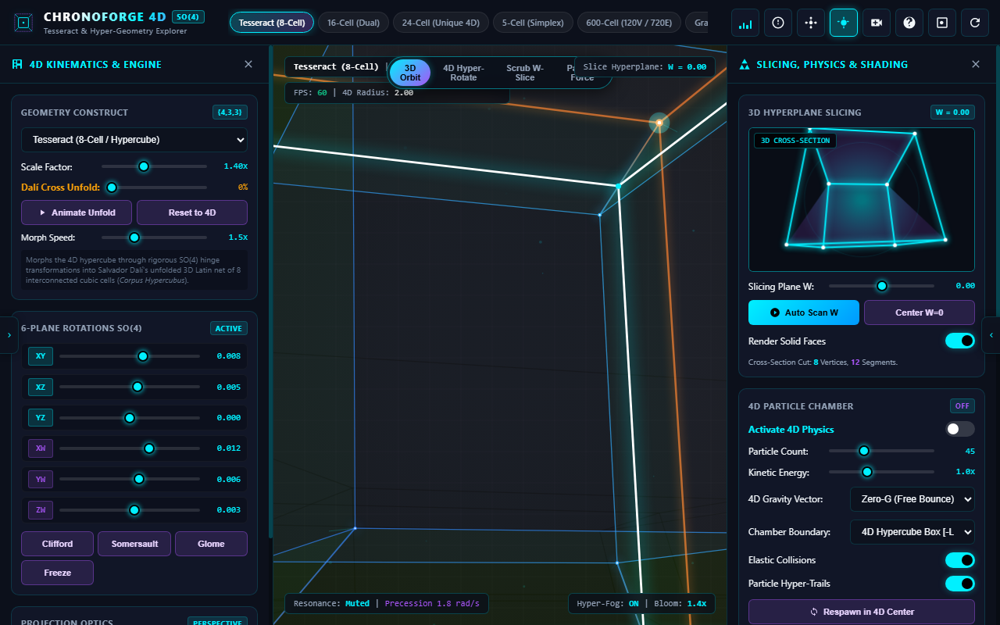
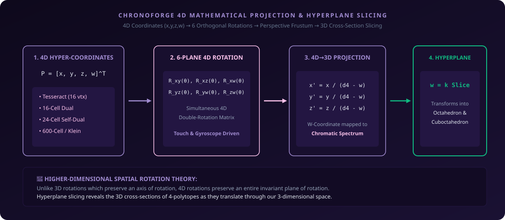

# ChronoForge 4D
### Non-Euclidean Tesseract & 4D Hyper-Geometry Explorer


[]()
[]()
[]()
[]()
[]()

---

## 📸 Live Application Interface


*Figure 1: ChronoForge 4D running live in browser — showing real-time 4D rotation across the XW and YW hyperplanes with 3D hyperplane cross-section slicing.*

---

## 🌟 Overview

**ChronoForge 4D** is a non-Euclidean spatial visualizer and 4-dimensional geometric engine. Because human vision cannot directly perceive four spatial dimensions, ChronoForge uses linear algebra matrix transformations to project 4D polytopes onto a 3D perspective volume, which is then mapped to the 2D display canvas.

The platform includes real-time **3D cross-sectional hyperplane slicing**, revealing the transforming 3D polyhedra formed as a 4D solid passes through a 3D space.

---

## 📐 Mathematical Formulation



### 1. 6-Plane 4D Rotational Matrices
While 3D space has only 3 rotational axes, 4-dimensional space allows independent simultaneous rotations across **6 orthogonal planes**:

$$R_{xy}(\theta), \quad R_{xz}(\theta), \quad R_{xw}(\theta), \quad R_{yz}(\theta), \quad R_{yw}(\theta), \quad R_{zw}(\theta)$$

For example, rotation in the $XW$ hyperplane by angle $\alpha$:
$$\begin{bmatrix} x' \\ y' \\ z' \\ w' \end{bmatrix} = \begin{bmatrix} \cos\alpha & 0 & 0 & -\sin\alpha \\ 0 & 1 & 0 & 0 \\ 0 & 0 & 1 & 0 \\ \sin\alpha & 0 & 0 & \cos\alpha \end{bmatrix} \begin{bmatrix} x \\ y \\ z \\ w \end{bmatrix}$$

### 2. 4D-to-3D Perspective Projection
Using camera distance $d_4$ along the 4th axis:
$$x_3 = \frac{x}{d_4 - w}, \quad y_3 = \frac{y}{d_4 - w}, \quad z_3 = \frac{z}{d_4 - w}$$

### 3. Hyperplane Slicing ($w = k$)
Calculates exact linear edge intersections with the 3D slicing hyperplane $w = k$. As $k$ sweeps across the 4th dimension, users witness a Tesseract appear as a point, grow into an octahedron, expand into a cuboctahedron, and contract symmetrically.

---

## 🌌 Supported 4D Polytopes
- **Tesseract (8-Cell / Hypercube)**: 16 vertices, 32 edges, 24 square faces, 8 cubic cells.
- **16-Cell (Hexadecachoron)**: The regular 4D cross-polytope dual of the tesseract.
- **24-Cell (Icositetrachoron)**: A unique self-dual 4D polytope with no 3D equivalent.
- **600-Cell**: 120 vertices, 720 edges, and 600 tetrahedral cells.
- **4D Klein Bottle & Clifford Torus**: Non-orientable topological manifolds.

---

## 🎮 Navigation & Mobile Gyroscope
- **Desktop**: Click and drag across different canvas zones to engage $XY, XZ$ vs $XW, YW$ rotation.
- **Mobile / Tablet**: Built-in DeviceOrientation API links device tilt and gyroscope directly to 4D precession.

---

## 🚀 How to Run

1. Clone repository:
```bash
git clone git@github.com-podev:pushpikaodisha/chronoforge-4d.git
cd chronoforge-4d
```
2. Open **`index.html`** in any modern web browser.
3. No build tools or installations needed — 100% self-contained.

---

## 👤 Author & Maintainer
- **Engineer**: Pushpika Odisha
- **Email**: pushpikaodisha.dev@gmail.com
- **GitHub**: [@pushpikaodisha](https://github.com/pushpikaodisha)
